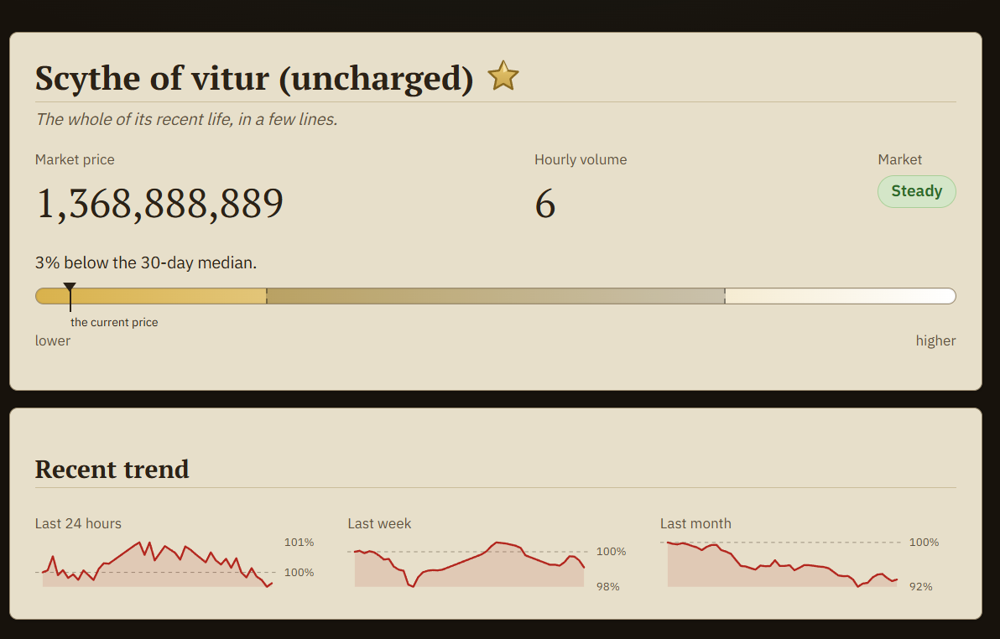

# Geoffery

A price oracle and decision assistant for Old School RuneScape's Grand Exchange —
~4,600 item pages with a deal gauge, market-regime label, sparklines, and **the Butler's
Bell**: an elderly ledger-keeper who turns your intent (buy/sell + time tolerance) into a
recommended price, logs it as a falsifiable prediction, and is scored against the market.

All-TypeScript monorepo: a pure domain core with zero I/O; a two-layer store (an append-only
R2 archive + a queryable D1/SQLite store); a static Astro site. Runs on **localhost** for
development and deploys to **Cloudflare** (Workers + Pages) at `geoffery.gg`.

**Live site: <https://geoffery.gg>**



**Where to look**
- `SYSTEM_ARCHITECTURE.md` — as-built module map, data flow, and system invariants
- `docs/RECOMMENDATION-METHODOLOGY.md` — how a recommended price is derived and scored
- `packages/core` — the pure domain layer (zero I/O, enforced by `npm run check:purity`)

> The live data pipeline has been paused since 2026-08-25 to stay within Cloudflare D1's free
> tier, so prices on the site are a snapshot. Restoring it is waiting on making the
> aggregator scan incremental (see `ops/wrangler/*.toml`).

Source shared for portfolio review. All rights reserved.

## Deploy a new version

Versions follow **`MAJOR.MINOR.PATCH`** semver. Bump with one of these (it edits
`package.json`, commits, and tags), then push — CI builds from live prod data and deploys to
`geoffery.gg`:

```bash
npm version patch     # bugfix / no behaviour change    e.g. 0.1.0 → 0.1.1
npm version minor     # new feature, backwards-compatible     0.1.1 → 0.2.0
npm version major     # breaking change                       0.2.0 → 1.0.0
npm version 1.4.2     # or set an exact version

git push --follow-tags origin main    # deploy the bumped version
```

**Example** — ship a bugfix and confirm it:

```bash
npm version patch                       # 0.1.0 → 0.1.1
git push --follow-tags origin main      # CI deploys
curl https://geoffery.gg/version.json   # → {"version":"0.1.1", ...}
```

- Deploy by hand (no CI): `./ops/run.sh prod publish`
- Prod refuses to ship an older version than what's live; override a deliberate rollback with
  `GEOFFERY_FORCE_DEPLOY=1 ./ops/run.sh prod deploy-site`.

First-time prod setup (provisioning, domain attach, AdSense) is a one-off — see `docs/GO-LIVE.md`.

## Run it on localhost

```bash
nvm use && npm ci
cp .env.example .env                     # edit; never paste secrets in chat

npm run migrate:legacy                   # Phase 0 — export all price history (once)
npm run migrate:verify                   # GATE 0 — reconcile + spot-check
npm run backfill                         # archive → local D1 (SQLite)
npm run backtest                         # cold-start calibration + track record
npm run pipeline                         # collect → aggregate → news → export
npm run dev                              # scheduler + consult (:8787) + site (:4321)
```

Open <http://127.0.0.1:4321>. Optional: add `ANTHROPIC_API_KEY` to `.env` for the Haiku news
classifier (without it, updates are stored but unannotated — the site is unaffected).

## Layout
| Path | What |
| --- | --- |
| `packages/core` | Pure domain: rounding, gauge, regime, offers, scoring, ledger (zero I/O) |
| `packages/data` | Storage adapters: R2 archive codec, D1 SqlStore, wiki/MediaWiki clients |
| `packages/content` | All of Geoffery's words + design tokens (the sole source of his voice) |
| `workers/*` | collector · aggregator · scorer · news (cron) · consult (HTTP) |
| `site` | Astro static site + PWA |
| `tools/*` | `migrate-legacy` (Phase 0) · `backtest` |
| `ops` | `run.sh`, scheduler, `dev-up`, wrangler configs (owned by the `db` agent) |
| `docs` | runbook, go-live, ad policy, and the rest (see `docs/README.md`) |
| `config` | relocatable build config not bound to root discovery (`tsconfig.base.json`) |

## Checks
```bash
npm run check         # typecheck + eslint + core-purity + repo-layout + unit/property tests
npm run restore:drill # R2 restore drill (sha256 integrity + row reconciliation)
```

See `docs/README.md` (full doc index), `SYSTEM_ARCHITECTURE.md` (as-built module map +
routing), `docs/RUNBOOK.md` (ops), and `docs/GO-LIVE.md` (first-time launch).

Not affiliated with or endorsed by Jagex.
