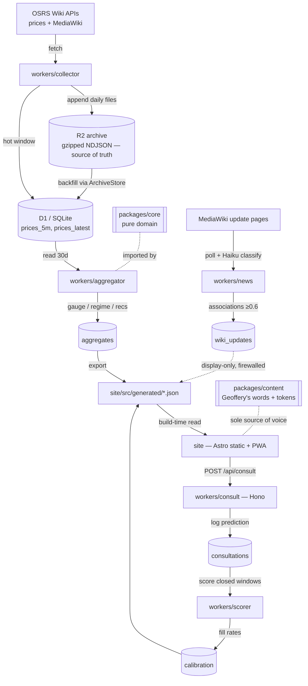

# Geoffery System Architecture

This document is the in-repo source of truth for *what* Geoffery is: its modules, their public
surfaces, the contracts between them, and the system-wide invariants. It documents the **as-built**
system (verified against the tree). For *how agents coordinate*, see `.claude/CHARTER.md` and
`.claude/prompts.md`; the symptom→owner routing table is §5 below. (A detailed product spec and a
decision ledger are maintained privately by the owner under `local/`, gitignored — not in the repo.)

The product is **non-agentic at runtime**: cron jobs, pure functions, and static pages. The only
production LLM call is the batch news classifier (§2.7); no user-facing path waits on it.

## 1. System overview

Prices flow from the OSRS Wiki API through the **collector** into the two-layer store: an
append-only **R2 archive** (the irreplaceable asset) and a **D1 hot window**. The **aggregator**
reads the trailing window, runs `packages/core` (pure), and writes per-item **aggregates**. The
**export** step writes build-time JSON the **static site** reads — the site touches no DB or
external API at request time. The **Bell** on every page posts a falsifiable prediction to the
**consult** worker; the **scorer** evaluates closed windows and rebuilds **calibration**, which
feeds the published fill rates. The **news** worker classifies wiki updates via Haiku — display
only, firewalled from prices. `packages/content` is the sole source of Geoffery's words.

Localhost runtime is Node-portable (workers as Node entries + a Hono consult server; `node:sqlite`
stands in for D1, local gzipped files for R2, and the local store holds the full migrated history
rather than a rolling hot window). Production targets Cloudflare; the worker handlers are written
portable and a `worker.ts` wraps each with bindings.

### Agent fleet topology

The fleet is **four agents** under `.claude/agents/` (consolidated 2026-06-12); subagents live in
a folder named after their parent:

| Area / module | Owning agent | Subagents (folder) |
| --- | --- | --- |
| webpage visual elements + the Geoffery character: `packages/content` (voice + identity), tokens, assets, the visual eye (OSRS Wiki as explicit aesthetic reference) | `design` | `design/geoffery` (final taste authority, prevails over `design`), `design/compliance` (IP / data-source / ad-category review, read-only, veto) |
| `site`, Bell UI, consult surface, PWA, ads, URLs/titles/sitemap/structured data, tips/ads/ledger economics | `web-app` | `web-app/page-smith`, `web-app/dialogue-smith`, `web-app/growth-seo`, `web-app/monetization` |
| `packages/data`, collector, news, export, `ops/`, deploys, monitoring, backups | `db` | `db/collector-smith`, `db/schema-smith`, `db/infra-smith`, `db/watch-smith` |
| `packages/core`, aggregator, scorer, backtest | `core` | `core/engine-smith`, `core/backtest-smith` |

Orchestration (sequencing, gates, deadlocks — formerly `product-lead`) belongs to the main
session per `.claude/CHARTER.md`.

**Smiths** handle complex build tasks; accountability stays with the parent agent. Two roles carry
the **chrome-devtools MCP** browser loop: `web-app` (+ `web-app/page-smith`, `web-app/dialogue-smith`)
implements and observes the rendered page; `design` is the independent visual eye consulted before
a visual change ships; `design/geoffery` rules on artistic direction; `design/compliance` audits
the rendered page read-only (no `Edit`/`Write`) and holds a veto. This implementer/critic
separation is enforced at each agent's `tools` declaration.

## 2. Per-module sections

Each block: **Owning agent · Purpose · Owned data · Public API/interface · Runtime deps.**

### 2.1 packages/core
- **Owning agent**: `core` (`core/engine-smith`, `core/backtest-smith`).
- **Purpose**: the pure domain — rate prices, classify regime, recommend offers, score predictions,
  compute ledger tiers. **Zero I/O** (mechanically verified).
- **Owned data**: none persistent. Tuned constants are module-local source (logged in `docs/SALVAGE.md`).
- **Public API**: `roundForSide`/`roundSig`; `computeAggregate`, `weightedQuantiles`, `band`,
  `verdictText`; `classify`, `liquidityBand`; `recommend`, `recommendAll`, `ENGINE_VERSION`;
  `filledWithinWindow`, `scorePrediction`, `fillRateByCohort`, `WINDOWS`; `tierForFixed`,
  `assignTiers`; `watchScore` (homepage "items of note" ranking); `slugify`, `assignSlugs`; all
  shared `types`.
- **Runtime deps**: none. Importing `node:*`, `fetch`, env, or `@geoffery/data` is a build error
  (ESLint + `tools/check-core-purity.mjs`). `offers.ts` additionally imports nothing news/wiki-shaped.

### 2.2 packages/data
- **Owning agent**: `db` (`db/schema-smith`).
- **Purpose**: storage adapters only — the seam workers bind to. No business math.
- **Owned data**: all persisted schema (`schema.ts`, ported verbatim for byte-trivial D1 migration).
- **Public API**: `ArchiveStore`/`LocalArchiveStore` + `DayWriter` (R2 daily-file codec);
  `SqlStore`/`SqliteStore` + `openStore` (D1 seam); the typed repo helpers (`upsertItem`,
  `snapshotsForItem`, `writeAggregate`, `insertConsultation`, `pendingConsultations`,
  `replaceCalibration`, `calibrationSummary`, `recentWikiNotices`, `heartbeat`, `staleJobs`, …);
  the wiki clients (`fetchMapping`/`fetchLatest`/`fetch5m`, `fetchWikiUpdates`); `loadConfig`.
- **Runtime deps**: `@geoffery/core` (types only), `node:sqlite`, `node:zlib`, `fetch`.

### 2.3 packages/content
- **Owning agent**: `design`.
- **Purpose**: **the sole source of every string Geoffery speaks** + the design tokens.
- **Owned data**: dialogue trees + page copy (`lines.ts`), ledger tier copy (`ledger.ts`), tokens
  (`tokens.css`), the portrait asset.
- **Public API**: `SITE`, `HOME`, `GAUGE`, `BELL`, `PAGES`, `NEWS`, `LEDGER`, `toleranceWindowPhrase`, `@geoffery/content/tokens.css`.
- **Runtime deps**: `@geoffery/core` (the `Tolerance` type only).

### 2.4 workers/collector
- **Owning agent**: `db` (`db/collector-smith`).
- **Purpose**: live ingestion (cron) — fetch latest/5m/mapping → archive append + hot-window upsert + heartbeat. Backfill loads the migrated archive through the shared reader.
- **Owned data**: writes `items`, `prices_latest`, `prices_5m`, the current archive day, the `collector` heartbeat.
- **Public API**: `runCollect(store, archive, userAgent, now)` (portable handler).
- **Runtime deps**: `packages/data` (store + archive + wiki client), `packages/core` (`assignSlugs`).

### 2.5 workers/aggregator
- **Owning agent**: `core` (`core/engine-smith`).
- **Purpose**: recompute the gauge + regime + six recommendations for every item via a single
  sequential scan of the trailing 30-day window.
- **Owned data**: writes the `aggregates` table; the `aggregator` heartbeat.
- **Public API**: `runAggregate(store, now)` (portable handler).
- **Runtime deps**: `packages/core` (`computeAggregate`), `packages/data` (reads/writes).

### 2.6 workers/scorer
- **Owning agent**: `core` (`core/backtest-smith`).
- **Purpose**: evaluate consultations whose tolerance window has closed against subsequent 5m data; rebuild per-cohort calibration.
- **Owned data**: writes `consultation_outcomes`, `calibration`; the `scorer` heartbeat.
- **Public API**: `runScorer(store, now)` (portable handler).
- **Runtime deps**: `packages/core` (`scorePrediction`, `fillRateByCohort`, `WINDOWS`), `packages/data`.

### 2.7 workers/news
- **Owning agent**: `db` (reviewed by `design/compliance`).
- **Purpose**: poll the OSRS Wiki update pages (MediaWiki API), diff, and classify each new entry
  once via **Claude Haiku** against a closed item vocabulary (quoted justification + confidence;
  only ≥0.6 surfaces). Permanent cache; `llm_usage` accounted. Graceful degradation without a key.
- **Owned data**: writes `wiki_updates`, `update_item_associations`, `llm_usage`; the `news` heartbeat.
- **Public API**: `runNews(store, userAgent, apiKey, model, maxUpdates, now)`.
- **Runtime deps**: `packages/data` (wiki client + repo), `@anthropic-ai/sdk` (optional).

### 2.8 workers/consult
- **Owning agent**: `web-app` (browser-facing contract) + `core` (cohort key); `web-app/dialogue-smith` builds it.
- **Purpose**: HTTP (Hono) — log each consultation as a falsifiable prediction. No price math (the
  price was computed at export time and shown to the user; we log exactly that).
- **Owned data**: writes `consultations`.
- **Public API**: `POST /api/consult` (body: slug, side, tolerance, recommendedPrice, regime*, liquidityBand); `GET /api/health`. `logConsultation(store, body, clientId, now)` is the portable handler.
- **Runtime deps**: `hono` + `@hono/node-server`, `packages/data`, `packages/core` (`ENGINE_VERSION`).

### 2.9 site
- **Owning agent**: `web-app` (`web-app/page-smith`, `web-app/dialogue-smith`); `web-app/growth-seo` (URLs/SEO), `web-app/monetization` (money/ledger/ads), `design` (copy/tokens), `design/compliance` (trade dress + disclaimer).
- **Purpose**: the static Astro site + PWA — ~4,572 item pages, instant search, the deal gauge, sparklines, the header-mounted Butler's Bell, the static pages (methodology/money/ledger/contact), the stubbed `/profile/`, sitemap + structured data.
- **Owned data**: none — reads ONLY `site/src/generated/*.json` at build time.
- **Public API**: routes `/`, `/item/<slug>/`, `/methodology|money|ledger|contact/`, `/profile/` (noindex stub), `/items.json`, `/rec/<slug>.json`, `/sitemap.xml`; the `/api/*` proxy to the consult worker in dev.
- **Runtime deps**: `@geoffery/content`, `@geoffery/core` (`assignTiers` etc. at build), the generated JSON.

### 2.10 tools
- **Owning agent**: `db` (`migrate-legacy`), `core` (`backtest`).
- **Purpose**: `migrate-legacy` — Phase-0 one-shot export of all reference history → R2 archive (+ `verify`, `restore-drill`). `backtest` — cold-start track record over the migrated history.
- **Owned data**: writes the archive (migrate) and `calibration` (backtest).
- **Public API**: CLI — `npm run migrate:legacy|migrate:verify|restore:drill|backtest`.
- **Runtime deps**: `packages/data`, `packages/core`, `node:sqlite` (reads the legacy DB read-only).

### 2.11 ops
- **Owning agent**: `db` (`db/infra-smith`, `db/watch-smith`).
- **Purpose**: runtime orchestration + resilience — `dev-up` (the localhost stack), the scheduler, monitoring, the RUNBOOK, the Cloudflare wrangler configs (portable, not the localhost path).
- **Owned data**: none of its own; reads `pipeline_health`.
- **Public API**: CLI — `npm run dev|pipeline|export`; the scheduler cadences.
- **Runtime deps**: every worker entry (it spawns them), `packages/data` (config + health).

## 3. Inter-module contracts (the seams)

- **3.1 `ArchiveStore` (R2 seam)** — `readDay`/`streamRange`/`writeDay`/`appendDay`/`readManifest`.
  The one reader shared by migrate-legacy, the collector backfill, the aggregator, and the backtest;
  they cannot drift. On-disk format: gzipped NDJSON daily files + a sha256-stamped manifest.
- **3.2 `SqlStore` (D1 seam)** — `prepare/run/get/all/iterate/transaction`. Prod (D1 binding) and
  local (`node:sqlite`) adapters are surface-identical; a column addition on `prices_5m`/`aggregates`
  is a CONTRACT change (core + web-app read them).
- **3.3 The generated-JSON export** — `db` → `web-app`. Files: `items.json`,
  `aggregates.json` (keyed by slug; gauge + regime + six recs + `wikiNotices`), `sparklines.json`,
  `methodology-stats.json` (calibration summary), `news.json`, `meta.json`. The site reads these
  and nothing else at request time. Shape changes are CONTRACT.
- **3.4 `POST /api/consult`** — the Bell (`web-app`/`web-app/dialogue-smith`) → `workers/consult`. Body
  pins side/tolerance/recommendedPrice/regime/liquidity; the worker resolves slug→itemId and writes
  a `consultations` row. Fire-and-forget; the user never waits.
- **3.5 Cloudflare portability seam** — each worker is `handler(env)` + a Node entry (`main.node.ts`)
  and a prod `worker.ts` wiring D1/R2/KV bindings. The handler body is identical across both.

## 4. System invariants (cross-cutting; re-verified at every gate)

- **Core purity** — `packages/core` performs zero I/O (ESLint + `tools/check-core-purity.mjs`).
- **The §6 firewall** — update flags never alter a recommended price; `offers.ts` imports nothing
  news/wiki-shaped (lint + purity scan + a behavioural test that `recommend()` is invariant to the news flag).
- **Action-first verdicts** (tone rule reversed 2026-06-12) — gauge verdicts and band labels name
  the move (buy/hold/sell/wait). "Unsettled" is never suppressed to look confident.
- **Site reads only local data** — no DB or external API at request time; build-time JSON only.
- **Content is the sole source of voice** — no string Geoffery speaks lives outside `packages/content`.
- **Two-layer storage** — raw snapshots are append-only in the R2 archive (backed up, restore-tested);
  D1 holds a hot window + derived aggregates. The archive is the source of truth.
- **Directional rounding** — recommended prices ≤4 sig figs, buys up / sells down; the scorer
  evaluates the rounded price as shown.
- **Prescriptive only where measured** — Geoffery recommends only classes that are logged, scored,
  and calibrated. (Gauge verdicts also use action verbs as of 2026-06-12; the methodology page is
  qualitative and no longer publishes the fill record — it is scored internally.)
- **IP: rhyme, don't quote** — no Jagex characters, sprites, or actual game fonts/assets;
  `design/compliance` reviews every outward-facing asset and holds a veto; footer disclaimer on
  every page. Owner carve-out: the Geoffery dialogue box is deliberately *similar* to the OSRS
  chatbox (left portrait, similar font and colors), executed house-drawn with a CC0 look-alike font.

## 5. Symptom → owner routing

From an observable symptom to the accountable owner (the four-agent fleet of §1). The owners are
areas of the codebase; this is the triage map. `db` owns the repo-layout guard that keeps it honest.

| Symptom | Owner | Code home |
| --- | --- | --- |
| Stale prices / missed collector cycles | `db` | `workers/collector`, `packages/data` |
| Wrong verdicts / bad recommendations | `core` | `packages/core` (gauge/regime/offers/scoring) |
| Broken or slow pages | `web-app` | `site/` |
| Off-voice copy | `design` | `packages/content` |
| Billing / ads wrong | `web-app/monetization` | `site/` tip + ad components |
| Outages / cost spikes | `db` | `ops/`, schedulers |
| Search rankings / URLs | `web-app/growth-seo` | `site/` routing, sitemap |
| Aesthetic judgement / artistic direction | `design/geoffery` | review gate, no single file |
| "Is this allowed?" (IP / data source / ad category) | `design/compliance` | review gate, no single file |
| News annotation wrong / missing | `db` + `design/compliance` | `workers/news` |
| Ambiguous | the orchestrating session | — |
